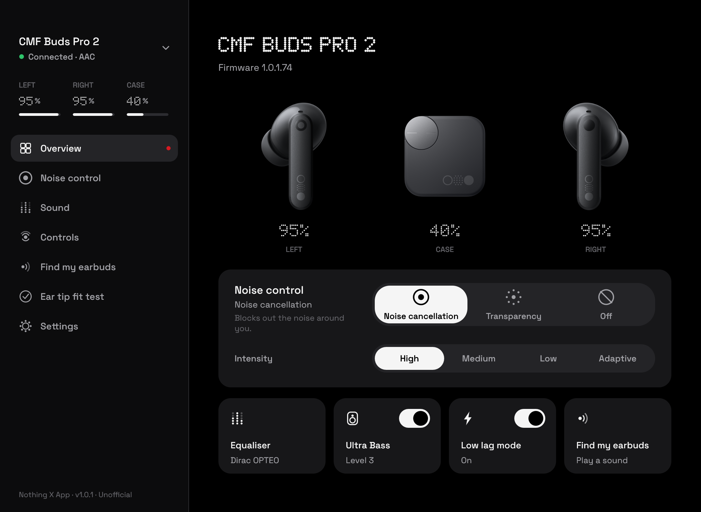
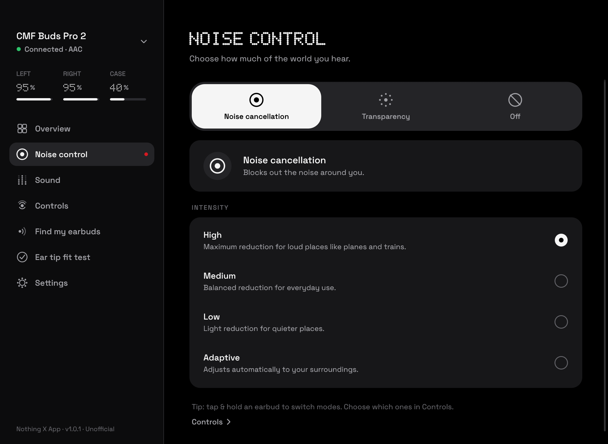
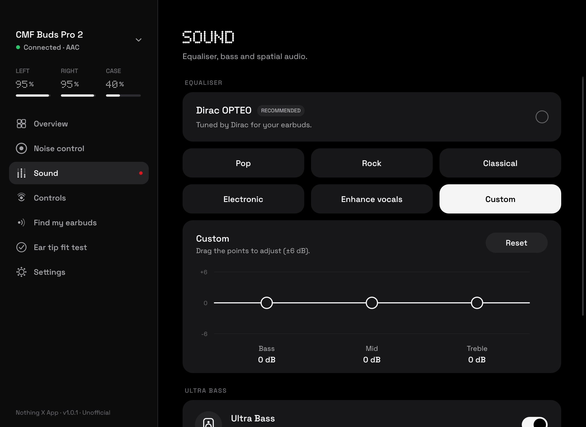
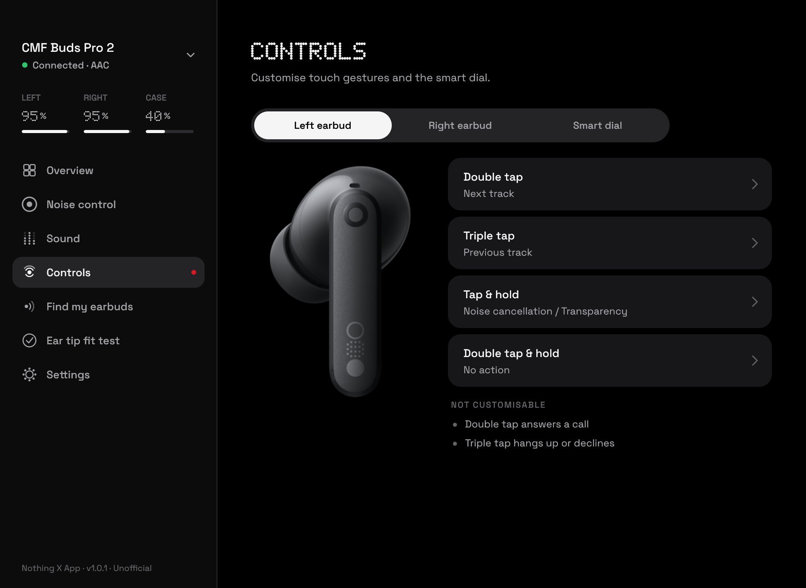
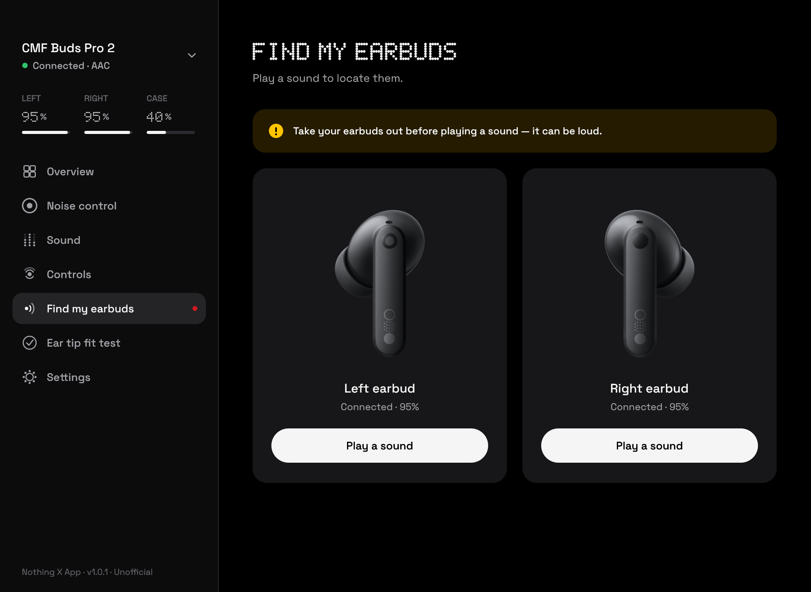
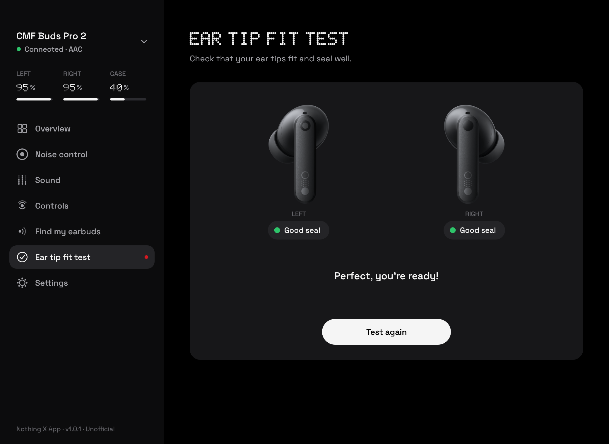
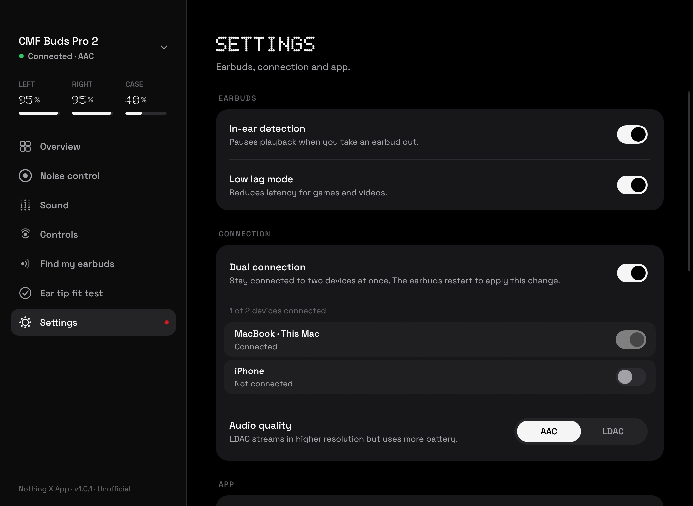
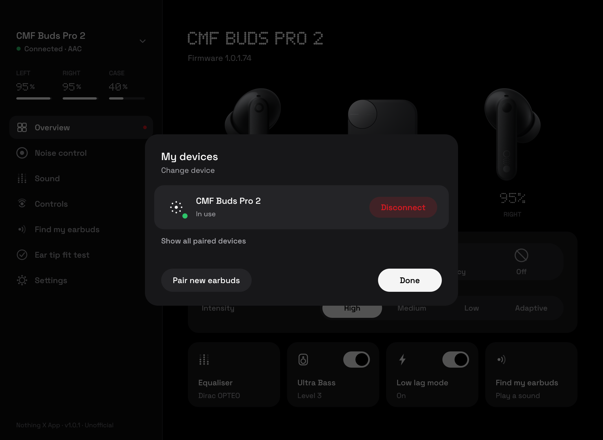
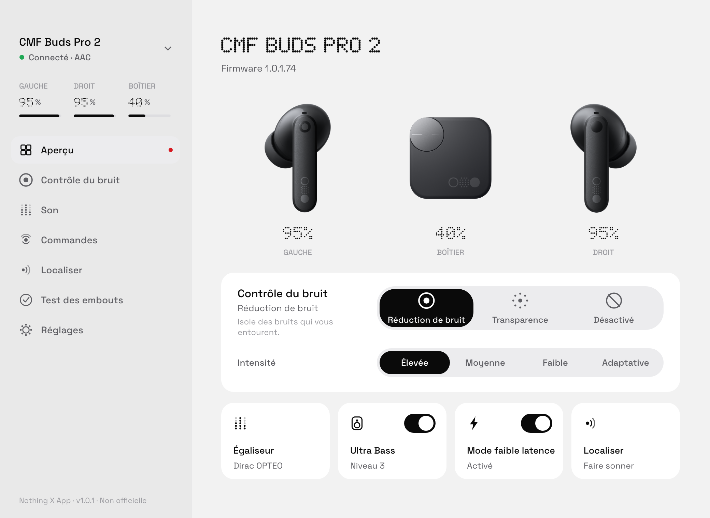

# Nothing X App for macOS (unofficial) — v1.0.1

A native macOS companion app, written in Rust, for **Nothing & CMF earbuds** (fully supported today: **CMF Buds Pro 2**, all revisions).
The interface follows the Nothing design language: monochrome, dot-matrix lettering, a red accent. It's laid out for the Mac with a sidebar and dedicated pages, in light or dark mode, and in five languages.

> **Unofficial, non-certified app.** It is not developed, affiliated with, endorsed or certified by Nothing Technology Limited. Use it at your own risk.
>
> The first Nothing X app for macOS was made by [eldandelion (Daniel)](https://github.com/eldandelion/nothing-x-macos), based on the work of Arunavo Ray. Thank you!

| Overview | Noise control | Sound (custom EQ) |
|---|---|---|
|  |  |  |

| Controls | Find my earbuds | Ear tip fit test |
|---|---|---|
|  |  |  |

| Settings | My devices | Light theme (French) |
|---|---|---|
|  |  |  |

## Features

* **Overview**
  * The connected earbuds' own Bluetooth name.
  * Battery for left, right and case, with charging and low-battery indicators.
  * The case only reports its level while an earbud is inside it (it has no Bluetooth of its own), so the app keeps the last level it saw and says how long ago it was measured.
  * Quick noise control.
  * Shortcuts to equaliser, Ultra Bass, low lag mode and Find my earbuds.
* **My devices**: click the device name at the top of the sidebar to see paired earbuds, switch between them, disconnect, or pair new ones.
* **Noise control**: noise cancellation, transparency or off; intensity High, Medium, Low or Adaptive, each with a description.
* **Sound**
  * Dirac OPTEO and presets.
  * 3-band custom EQ on a curve you drag directly (±6 dB).
  * Ultra Bass (5 levels) and spatial audio.
* **Controls**: double tap, triple tap, tap & hold (pick the noise modes to cycle through) and double tap & hold for each earbud, plus every smart dial gesture.
* **Find my earbuds**, **Ear tip fit test**.
* **Settings**
  * In-ear detection and low lag mode.
  * Dual connection: the list of devices connected to the earbuds.
  * Audio quality AAC or LDAC; the earbuds restart and the app reconnects on its own.
  * Language, appearance, and device details (model, firmware, serial number, address).
* **Languages**: English, French, Spanish, German, Italian. The app follows the macOS language by default, and you can change it in Settings.
* **Appearance**: System, Dark or Light.
* **Shortcuts**: ⌘1…⌘7 switch pages; Esc closes a dialog.
* **Full screen**: the interface keeps its size and stays centred.

## Compatibility

* **macOS 11 Big Sur or later**, on Apple Silicon and Intel Macs (universal binary). Developed and tested on a recent macOS release with real CMF Buds Pro 2 (firmware 1.0.1.74).
* **Earbuds:** CMF Buds Pro 2 are fully supported, in every colour. Other Nothing and CMF models are detected, and the app says that their settings are not supported yet.
* **CMF Watch** smartwatches are not supported. They use a different protocol, tied to the phone app.

## Install

**From the installer:** open `Nothing-X-App-1.0.1.dmg` (Apple Silicon and Intel, macOS 11 or later) and drag *Nothing X App* onto *Applications*. The installer window shows the steps, and *Lisez-moi - Read me.txt* gives the details in French and English.

* The app is not signed by an identified Apple developer, so macOS may block the first launch. Go to System Settings > Privacy & Security, click **Open Anyway** and confirm. On macOS 14 or earlier, right-click the app and choose **Open** instead.
* Allow **Bluetooth** access when macOS asks.

**From source** (needs Rust via `rustup` and the Xcode command-line tools):

```sh
scripts/bundle.sh                     # → dist/Nothing X App.app (native architecture)
scripts/make_dmg.sh                   # → dist/Nothing-X-App-<version>.dmg (universal installer)
```

`make_dmg.sh` needs both macOS targets: `rustup target add x86_64-apple-darwin aarch64-apple-darwin`.

### Good to know

* The earbuds must first be paired with the Mac and connected as an audio device.
* **Only one app at a time can use the earbuds' controls.** If *Ear (web)* is open in a browser, or the *Nothing X* app is connected on your phone, the Mac app shows a message and connects as soon as the channel is free.
* The app identifies the exact model and colour (Fast Pair), remembers your earbuds, connects on its own, and reconnects when they come out of the case.

## CLI: `nothingctl`

It's included in `Nothing X App.app/Contents/MacOS/`, or run it with `cargo run --bin nothingctl -- …`:

```sh
nothingctl list | status | monitor
nothingctl anc off|transparency|high|mid|low|adaptive
nothingctl eq dirac|pop|rock|classical|electronic|vocals|custom
nothingctl custom-eq 3 0 -2           # bass, mid, treble (−6…6)
nothingctl bass on 4 | bass off
nothingctl in-ear on|off · latency on|off
nothingctl --device aa-bb-cc-dd-ee-ff status
```

## Demo mode and visual checks

```sh
cargo run -- --demo                                         # simulated CMF Buds Pro 2
NOTHINGX_DEMO=1 NOTHINGX_LANG=de NOTHINGX_THEME=light cargo run
NOTHINGX_DEMO=1 NOTHINGX_SCENE=custom cargo run
#   scenes: noise, sound, custom, controls, dial, gesture, find, fit, fit-run, settings, about, devices, language, restart, case-away, unsupported
NOTHINGX_DEMO=1 NOTHINGX_SCREENSHOT=/tmp/shot.png cargo run # saves a screenshot, then quits
NOTHINGX_DEMO=1 NOTHINGX_CHECK_TEXT=1 NOTHINGX_LANG=de cargo run   # reports any text that doesn't fit its space
cargo run --release --example make_promo -- <dir> <main.png> <a.png> <b.png>   # social media images
```

Demo and test runs never write to your saved preferences.

## Architecture

```
crates/
  nothing-protocol/  Pure protocol, no I/O, unit-tested (including frames captured from real earbuds):
                     0x55 framing + CRC16, reassembly, commands, typed requests and events, DeviceState,
                     Fast Pair table, capabilities per model (B172 / B187 / B195)
  nothing-bt/        macOS transport: IOBluetooth through objc2 (SDP → RFCOMM channel, open, writes)
  nothing-x/         egui app (ui/: shell, pages, i18n, theme, widgets), `nothingctl` CLI, session engine
```

* **Bluetooth threading.** IOBluetooth runs on top of CoreBluetooth, which delivers its callbacks on the **main queue**. Every IOBluetooth call is therefore dispatched to the main thread through GCD, and the protocol engine runs on its own thread, separate from the UI.
* **Session.**
  * After connecting, it sends the read sequence one request every 100 ms.
  * Writes (`0xF0xx`) go out one at a time, each waiting for its ack (same operation id, 2 s timeout); a timeout raises a toast.
  * Updates the earbuds send on their own (battery, noise control, ear tip test, dual connection) refresh the state.
  * It reconnects with back-off, including after the earbuds restart.
* **Wire protocol** (little endian): `55 60 01 | cmd(2) | len(2) | op | payload | crc16`.
  * Reads (`0xC0xx`) are answered with `0x40xx`, writes (`0xF0xx`) are acked with `0x70xx`, and the earbuds push their own updates as `0xE0xx`.
  * The CMF Buds Pro 2 compute the CRC of their responses over the **payload only**; both forms are accepted.

## Credits and licences

* **First version:** [nothing-x-macos](https://github.com/eldandelion/nothing-x-macos) by eldandelion (Daniel), the first Nothing X app for macOS, based on the work of Arunavo Ray (GPL-3.0). This app is a Rust rewrite inspired by it.
* **Protocol:** a port of [Ear (web)](https://github.com/radiance-project/ear-web) (AGPL-3.0).
* Code: **AGPL-3.0-or-later** (see `LICENSE`).
* Font: Space Grotesk (SIL OFL 1.1). The dot-matrix lettering and the icons are drawn in code.
* Product images: © Nothing Technology Limited. "Nothing" and "CMF" are trademarks of Nothing Technology Limited.
